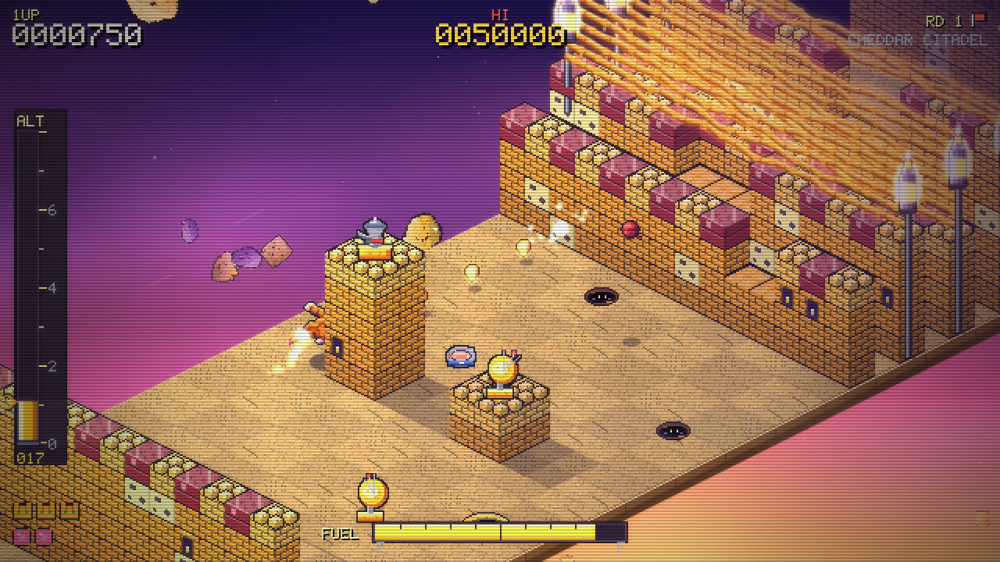
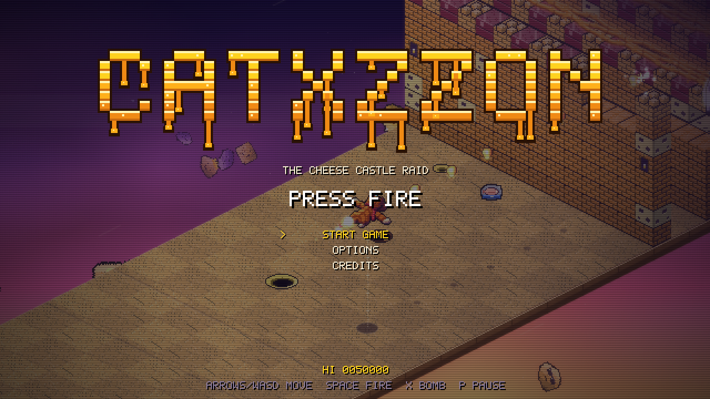
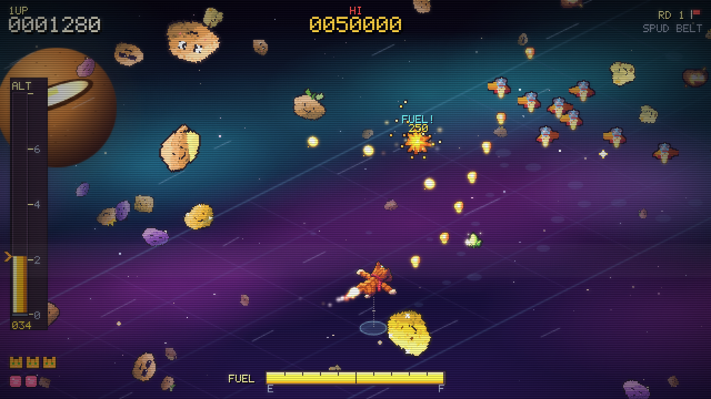
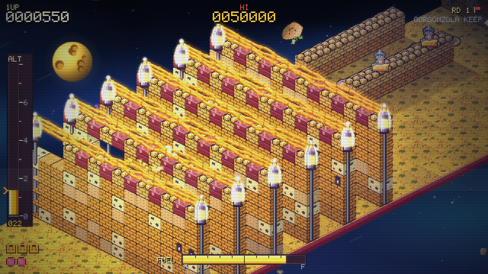
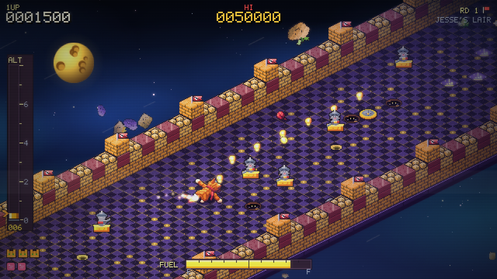

# CATXZZON

[](https://bsommers.github.io/catxzzon/play/)
[](https://github.com/bsommers/catxzzon/actions/workflows/pages.yml)
[](LICENSE)


**Play in your browser: https://bsommers.github.io/catxzzon/play/** (site: https://bsommers.github.io/catxzzon/)

An 80s **Zaxxon** clone in the KÄSEKRIEG universe: an isometric, diagonally scrolling shooter where altitude matters. You are Major Marmalade, a big orange tabby, and *the cat is the spaceship* (superman pose, tail as engine flame). Raid Schloss Gorgonzola, a castle of cheese held by grey-uniformed rats, slip through spray-cheese forcefields, cross the Spud Belt past potatoes in sunglasses, and take down Big Boss Jesse.



| | |
|---|---|
|  |  |
| Title screen | Spud Belt |
|  |  |
| Gorgonzola Keep | Jesse's Lair |

## Features

- Four stages: Cheddar Citadel, Spud Belt, Gorgonzola Keep, Jesse's Lair (boss). Levels are generated from a seed and get harder each round.
- Altitude play: cast shadow, altimeter, wall gaps and force fields you must fly over or under.
- Juice: screen shake, hit-stop, crumb particles, combo callouts, rainbow catnip mode, Jesse taunts.
- Zero assets and zero dependencies: every sprite is drawn by code into pixel buffers, every sound and the music are synthesized with WebAudio, plain ES modules, no bundler to play.
- Keyboard, gamepad and touch input; high-score table; options menu.
- Deterministic simulation (seeded RNG), so an autopilot bot can play and test it headless.
- Ships as a single 237 KB HTML file and as ~1 MB desktop apps (Linux, Windows, macOS).

## Controls

| Action | Keys |
|---|---|
| Move / altitude | Arrow keys or WASD (up/down climbs and dives) |
| Fire | Space or Z |
| Yarn bomb | X or Shift |
| Pause | P or Esc |

Gamepad and touch controls work too. See [docs/HOW-TO-PLAY.md](docs/HOW-TO-PLAY.md).

## Quick start

- **Browser:** https://bsommers.github.io/catxzzon/play/
- **Download:** grab an executable (Linux, Windows, macOS) or the single `catxzzon.html` from [Releases](https://github.com/bsommers/catxzzon/releases). Unsigned binaries: on macOS right-click, Open.
- **From source:** needs only Node 22+.
  ```sh
  npm start          # serves the game on http://localhost:4781
  npm test           # node:test suites
  node tools/build-web.mjs   # dist/web/ + dist/catxzzon.html (see docs/BUILD.md)
  ```

## Project layout

```
index.html style.css src/main.js   app shell, state machine
src/core/    defs, iso projection, rng, events, input, settings
src/sim/     deterministic simulation: game, player, shots, grid, enemies, boss, score, autopilot
src/levels/  seeded stage generators (fortress, space, boss)
src/art/     procedural pixel art (cat, castle, enemies, spuds, fx)
src/render/  iso painter, ground, voxel blocks, sprites, background, particles
src/audio/   WebAudio synth: engine, SFX, music
src/ui/      HUD, screens, menus, pixel font
tools/       serve, shot (headless Chrome), build-web, package-desktop, botplay, swarm-tracker
desktop/     Neutralinojs shell
docs/        guides, swarm reports, site
```

More: [HOW-TO-PLAY](docs/HOW-TO-PLAY.md), [ARCH-OVERVIEW](docs/ARCH-OVERVIEW.md), [HOW-IT-WAS-MADE](docs/HOW-IT-WAS-MADE.md), [BUILD](docs/BUILD.md), [LEARNINGS](docs/LEARNINGS.md).

## Credits

**For Jesse.** Original art, music and code; the whole game was built by a swarm of AI agents coordinated by an orchestrator (see [HOW-IT-WAS-MADE](docs/HOW-IT-WAS-MADE.md)). Desktop builds use [Neutralinojs](https://neutralino.js.org/) (MIT). Inspired by the 1982 arcade game Zaxxon; no original assets or code are used.

## License

[Apache License 2.0](LICENSE).
