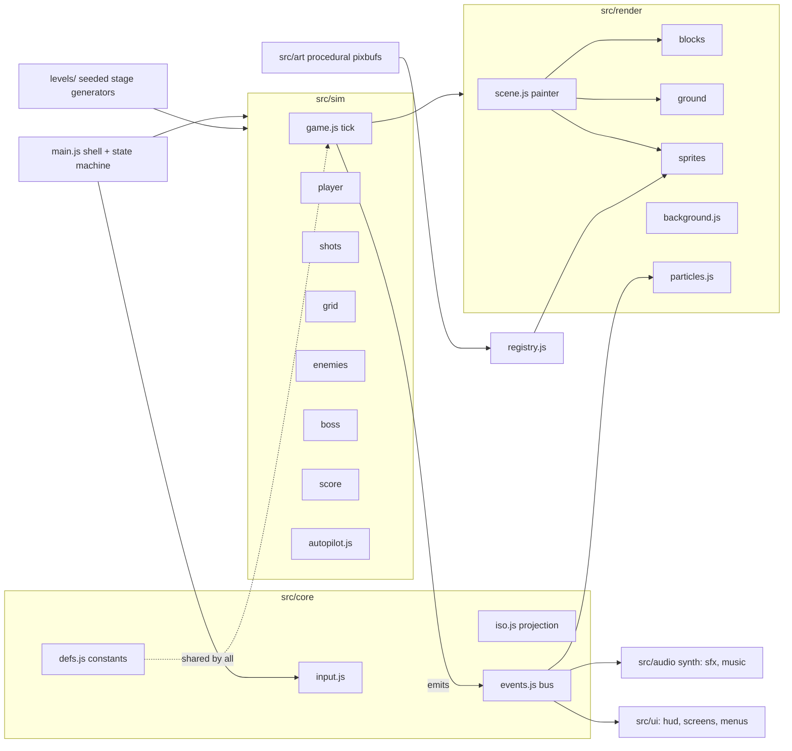

# Architecture overview

The binding contract is [ARCHITECTURE.md](../ARCHITECTURE.md); this page is the short tour. Rule of thumb: the **simulation is pure and deterministic** (no DOM, no `Math.random`), and everything else observes it through events and read-only state.

## Module map



## One frame

```
input.poll() -> game.step(input, dt)  (fixed timestep, seeded rng)
                     |  events: sfx, music, fx, shake, hitstop, popup, stage...
        +------------+-----------------+------------------+
        v                              v                  v
 renderer.draw(game)             audio (WebAudio)     ui/hud + popups
 background -> ground -> blocks+sprites merged by iso depth
 -> particles -> fog/light -> CRT post pass -> 640x360 canvas, integer-scaled
```

## Pieces

- **Coordinates.** World x is lateral, y forward (scroll), z up. `iso.project` maps to screen: forward is up-right, +x down-right, +z up. Depth sort key is `x - y + z`. Entities are boxes; stage geometry is a voxel grid of 16-unit cells.
- **Sim.** `game.js` owns the tick; `grid.js` answers voxel collisions, `player.js` handles flight and fuel, `enemies.js` and `boss.js` hold behaviours, `score.js` combos and bonuses. `autopilot.js` is an input generator, so a bot plays through the same API as a human.
- **Levels.** `buildStage(stageIdx, round, seed)` returns walls, force fields, spawn tables and decor; validated by `tools/validate-level.mjs`.
- **Art.** Each module exports `build()` returning pixel buffers (`PixBuf`) from code. `registry.js` builds them once into canvases, with placeholders swapped in place so rendering never waits.
- **Render.** Canvas 2D at 640x360. Cubes are shaded with cast shadows; sprites, voxels and shadows are merged into one painter's-algorithm list.
- **Audio.** Engine, SFX and a procedural music sequencer on WebAudio, with a stub path so Node tests can import everything.
- **UI.** Pixel font, HUD, title/options/credits/high-score screens, all drawn on the same canvas.
- **Packaging.** `tools/build-web.mjs` bundles with esbuild (fetched on demand) into `dist/web/` and a single inlined `dist/catxzzon.html`; `tools/package-desktop.mjs` wraps it with Neutralinojs. See [BUILD.md](BUILD.md).

## Testing

`npm test` runs node:test suites per module. `tools/botplay.mjs` plays headless via the autopilot, `tools/shot.mjs` drives headless Chrome for screenshots, `tools/smoke_web.sh` loads the single-file build over `file://` and fails on console errors.
