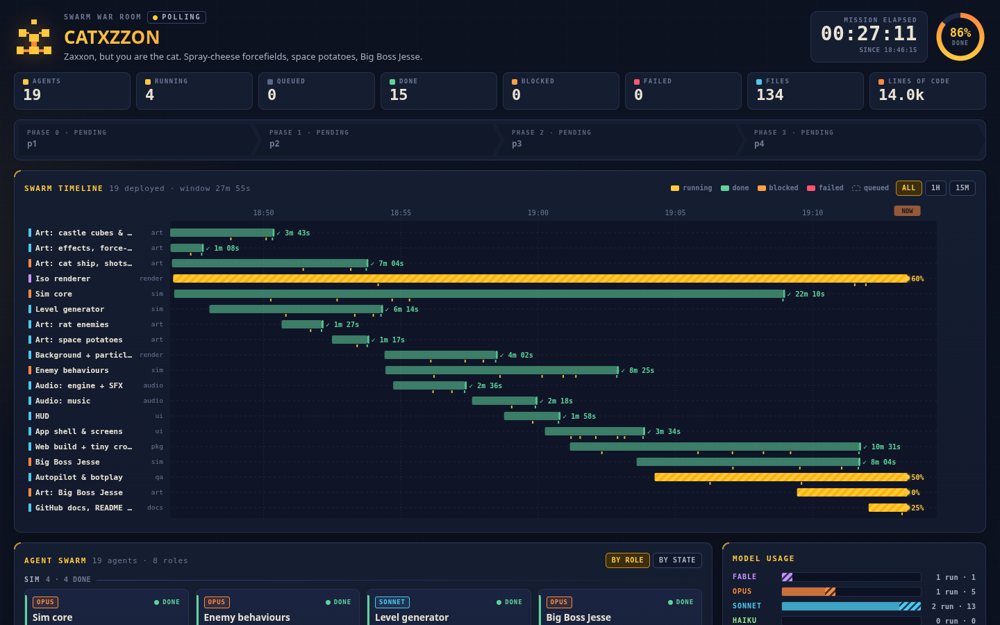

# How CATXZZON was made

CATXZZON was built by a swarm of 19 AI agents working in parallel from a single contract, coordinated by an orchestrator. No human wrote game code. The goal: a complete, polished arcade game with zero assets and zero runtime dependencies.

## The method

1. **Contract first.** [ARCHITECTURE.md](../ARCHITECTURE.md) and `src/core/defs.js` fix the coordinates, entity kinds, art manifest, event names and every module's API. If a module disagrees with it, the module is wrong.
2. **Ownership.** Each agent owns a short list of files and never edits anyone else's. Gaps go under "Requests" in its report.
3. **Phases.** p1 foundations (sim core, renderer, cat/fx/castle art, enemy behaviours), p2 content (levels, boss, enemy and spud art, background, audio), p3 shell (HUD, screens, QA bot), p4 packaging and docs.
4. **Checkpoints.** Each agent keeps `docs/swarm/progress/<id>.md` so a fresh agent can resume after an interruption.
5. **Verify for real.** Every agent runs, tests and looks at its work (headless Chrome screenshots, sprite sheets, node:test with mutation checks) before reporting. The orchestrator re-runs the tests.
6. **Tracker.** `tools/swarm-tracker` is a zero-dependency live dashboard: each agent calls `track.mjs <id> start|progress|done|blocked|failed`, and the "war room" page shows the timeline, model usage and files/lines. Run it with `npm run plan` then `npm run tracker`.

## Roster

| Agent | Model | Phase | Role |
|---|---|---|---|
| sim-core | opus | p1 | Deterministic simulation core |
| render-scene | fable | p1 | Isometric renderer |
| art-cat | opus | p1 | Cat ship, shots, items |
| art-fx | sonnet | p1 | Effects, force-field posts |
| art-castle | sonnet | p1 | Castle cubes and ground |
| sim-enemies | opus | p1 | Enemy behaviours |
| levels | sonnet | p2 | Level generator |
| sim-boss | opus | p2 | Big Boss Jesse behaviour |
| art-enemies | sonnet | p2 | Rat enemies |
| art-boss | opus | p2 | Big Boss Jesse art |
| art-spuds | sonnet | p2 | Space potatoes |
| render-fx | sonnet | p2 | Background and particles |
| audio-sfx | sonnet | p2 | Engine and SFX |
| audio-music | sonnet | p2 | Music |
| ui-hud | sonnet | p3 | HUD |
| ui-shell | sonnet | p3 | App shell and screens |
| qa-bot | sonnet | p3 | Autopilot and botplay |
| pkg-build | sonnet | p4 | Web build, desktop executables |
| docs-site | sonnet | p4 | README, docs, Pages site |

## Learnings and reports

- [LEARNINGS.md](LEARNINGS.md): mistakes and the rules they produced.
- [swarm/reports/](swarm/reports/): one report per agent (what was built, evidence, deviations, mistakes, learnings, requests).
- [swarm/SWARM.md](swarm/SWARM.md): the manifest and shared preamble every agent received.
- [BUILD.md](BUILD.md): how the web and desktop builds work.
